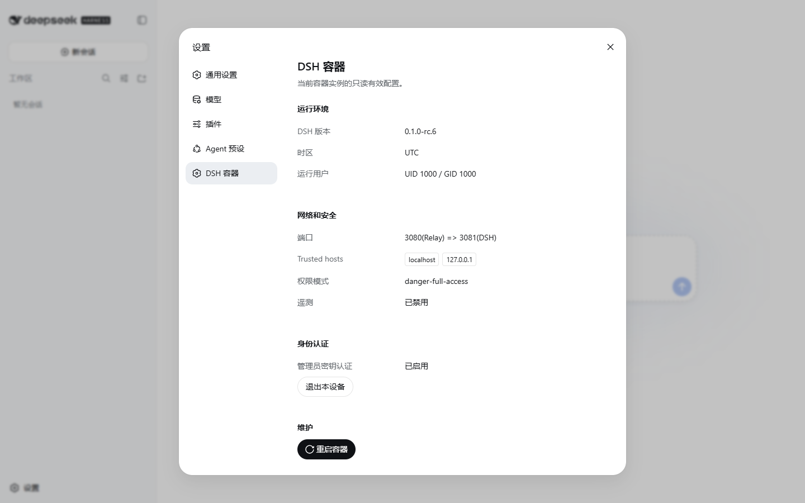
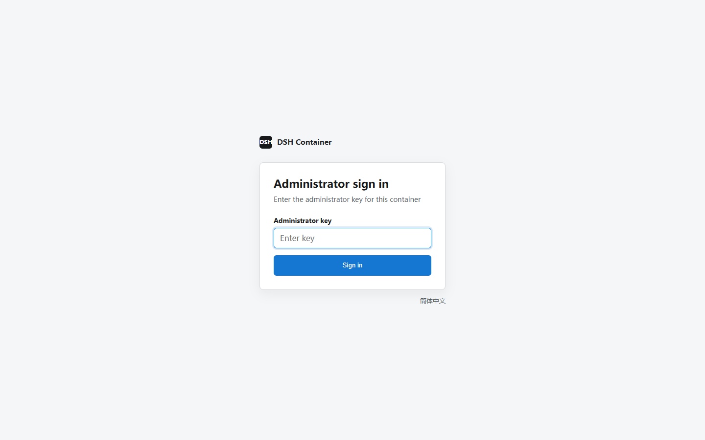

English | [简体中文](README.md)

# dsh-container

[](https://github.com/omdsh-dev/dsh-container/actions/workflows/publish-ghcr.yaml)

`dsh-container` packages the npm release of [DeepSeek Harness](https://github.com/deepseek-ai/deepseek-harness) as a ready-to-run Docker service for `linux/amd64` and `linux/arm64`.

- **Ready to run:** DSH and its runtime dependencies are preinstalled; no Node.js or npm setup is required on the host.
- **LAN access:** Access the Web UI from multiple devices, including over plain HTTP and from headless hosts.
- **Optional key authentication:** One shared administrator key can protect every page, static asset, API, and WebSocket outside the login endpoint.
- **Hardened and persistent:** Runs as non-root; the recommended deployment uses a read-only root filesystem, drops Linux capabilities, and stores configuration and workspace data separately.
- **Web management:** View effective container settings and request a graceful restart from the Web UI.





> [!WARNING]
> **Do not expose this service directly to the public internet.** Set `DSH_CONTAINER_KEY` for LAN, reverse-proxy, or any non-local access; without it, any client that can reach the published port is admitted as the owner. The shared key is intended only for a trusted LAN or a single-administrator deployment behind external HTTPS and access policy. It does not replace TLS, multi-user authorization, or public access controls, and trusted-host is not authentication.

## Quick start

### Docker

```sh
docker run -d --name dsh-container --restart unless-stopped -p 127.0.0.1:3080:3080 -e "DSH_CONTAINER_TRUSTED_HOSTS=localhost,127.0.0.1" ghcr.io/omdsh-dev/dsh-container:latest
```

Open <http://localhost:3080> after the health check passes. This command is for a disposable trial: settings and workspace data are lost when the container is removed.

For LAN or reverse-proxy access, add `-e "DSH_CONTAINER_KEY=your-private-key"` to enable single-administrator authentication first. See the [guide](docs/guide.en.md) for key validation, cookie behavior, the advertised public URL, and reverse-proxy requirements.

### Docker Compose

```sh
cp .env.example .env
mkdir -p .dsh workspace
sudo chown -R 1000:1000 .dsh workspace
docker compose up -d --build
```

Compose builds the image from the current repository and allows local access only by default.

## Documentation

The [complete guide](docs/guide.en.md) covers persistent deployment, LAN access, configuration, Web UI management, security, and updates.

## License

[MIT](LICENSE)
