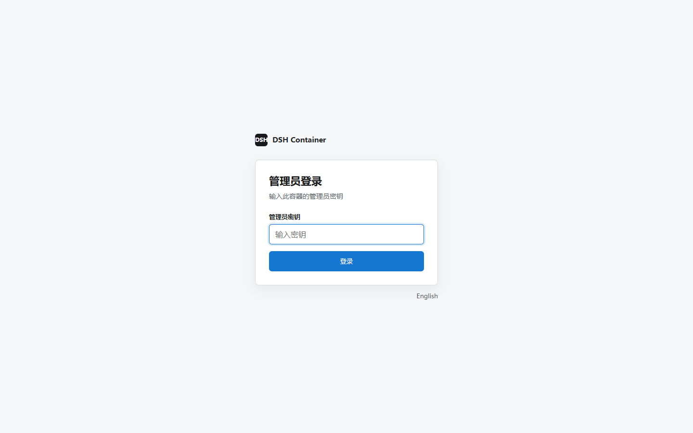

[English](README.en.md) | 简体中文

# dsh-container

[](https://github.com/omdsh-dev/dsh-container/actions/workflows/publish-ghcr.yaml)

`dsh-container` 将 npm 发布版的 [DeepSeek Harness](https://github.com/deepseek-ai/deepseek-harness) 封装为支持 `linux/amd64` 和 `linux/arm64` 的开箱即用 Docker 服务。

- **开箱即用：** 预装 DSH 与运行依赖，宿主机无需安装 Node.js 或 npm 包。
- **局域网访问：** 支持多台设备访问 WebUI，兼容普通 HTTP 与无头主机环境。
- **可选密钥认证：** 一个共享管理员密钥可保护登录页之外的全部页面、静态资源、API 和 WebSocket。
- **容器加固与持久化：** 镜像以非 root 用户运行；推荐使用只读根文件系统、删除 Linux capabilities，并独立保存配置与工作区。
- **Web 端管理：** 可在 WebUI 中查看容器有效配置，并发起平滑重启。




> [!WARNING]
> **请勿将本服务直接暴露到公网。** 可选共享密钥只适用于可信局域网或外部 HTTPS/访问策略后的单管理员场景，不能替代 TLS、多用户授权和公网访问控制。trusted-host 也不是身份认证。

## 快速开始

### Docker

```sh
docker run -d --name dsh-container --restart unless-stopped -p 127.0.0.1:3080:3080 -e "DSH_CONTAINER_TRUSTED_HOSTS=localhost,127.0.0.1" ghcr.io/omdsh-dev/dsh-container:latest
```

健康检查通过后访问 <http://localhost:3080>。此命令适合临时体验，删除容器后设置和工作区数据会丢失。

如需启用单管理员认证，在命令中增加 `-e "DSH_CONTAINER_KEY=你的私有密钥"`。完整的密钥规则、Cookie 行为和反向代理要求见[使用指南](docs/guide.md#管理员密钥认证)。

### Docker Compose

```sh
cp .env.example .env
mkdir -p .dsh workspace
sudo chown -R 1000:1000 .dsh workspace
docker compose up -d --build
```

Compose 会从当前仓库构建镜像，并默认仅允许本机访问。

## 完整文档

[完整使用指南](docs/guide.md)包含持久化部署、局域网访问、配置、WebUI 管理、安全说明和更新方法。

## 许可证

[MIT](LICENSE)
